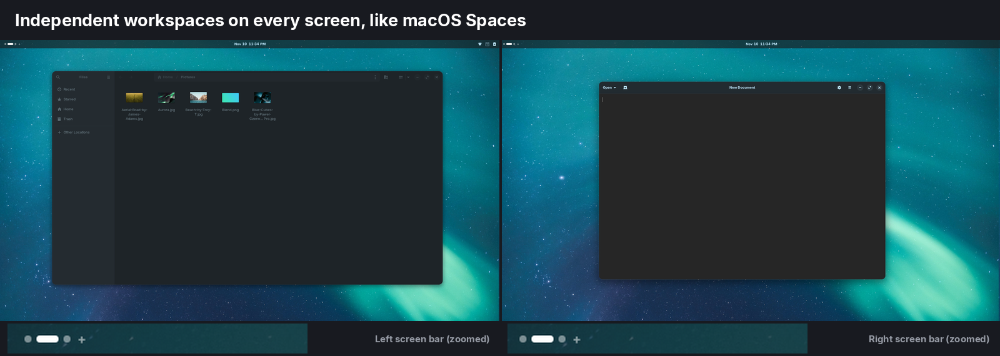
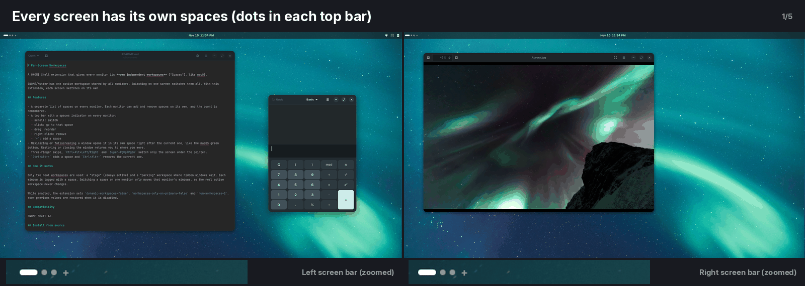
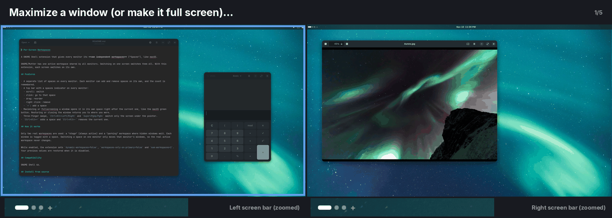
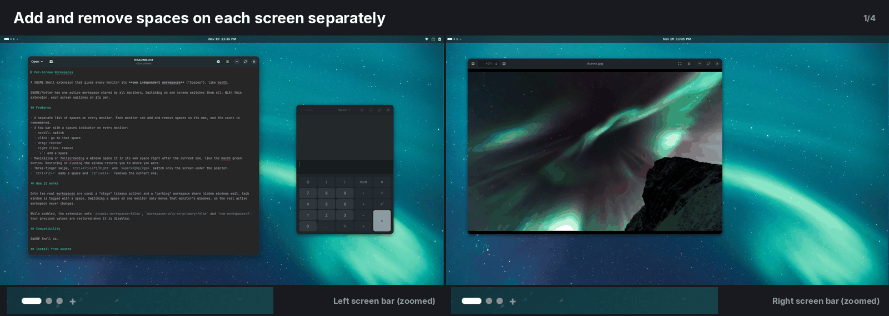

# Per-Screen Workspaces

**Independent workspaces on every monitor for GNOME Shell, like macOS Spaces.**

By default, GNOME has one active workspace shared by all screens: switching on one screen switches them all. With this extension, each monitor has its own workspaces and switches on its own.



### Each screen switches on its own


### Maximize = its own space (like the macOS green button)


### Add, remove and reorder spaces per screen


Install it from [extensions.gnome.org](https://extensions.gnome.org/extension/11718/per-screen-workspaces/).

## Features

- A separate list of spaces on every monitor. Each monitor can add and remove spaces on its own, and the count is remembered.
- A top bar with a spaces indicator on every monitor:
  - scroll: switch
  - click: go to that space
  - drag: reorder
  - right click: remove
  - `+`: add a space
- Maximizing or fullscreening a window opens it in its own space right after the current one, like the macOS green button. Restoring or closing the window returns you to where you were.
- Three-finger swipe, `Ctrl+Alt+Left/Right` and `Super+PgUp/PgDn` switch only the screen under the pointer.
- `Ctrl+Alt+=` adds a space and `Ctrl+Alt+-` removes the current one.

## How it works

Only two real workspaces are used: a "stage" (always active) and a "parking" workspace where hidden windows wait. Each window is tagged with a space. Switching a space on one monitor only moves that monitor's windows, so the real active workspace never changes.

While enabled, the extension sets `dynamic-workspaces=false`, `workspaces-only-on-primary=false` and `num-workspaces=2`. Your previous values are restored when it is disabled.

## Compatibility

GNOME Shell 46.

## Install from source

```sh
git clone https://github.com/slim8/per-screen-workspaces.git \
  ~/.local/share/gnome-shell/extensions/per-screen-workspaces@odin
glib-compile-schemas ~/.local/share/gnome-shell/extensions/per-screen-workspaces@odin/schemas
# log out and back in (Wayland), then:
gnome-extensions enable per-screen-workspaces@odin
```

## License

GPL-2.0-or-later
